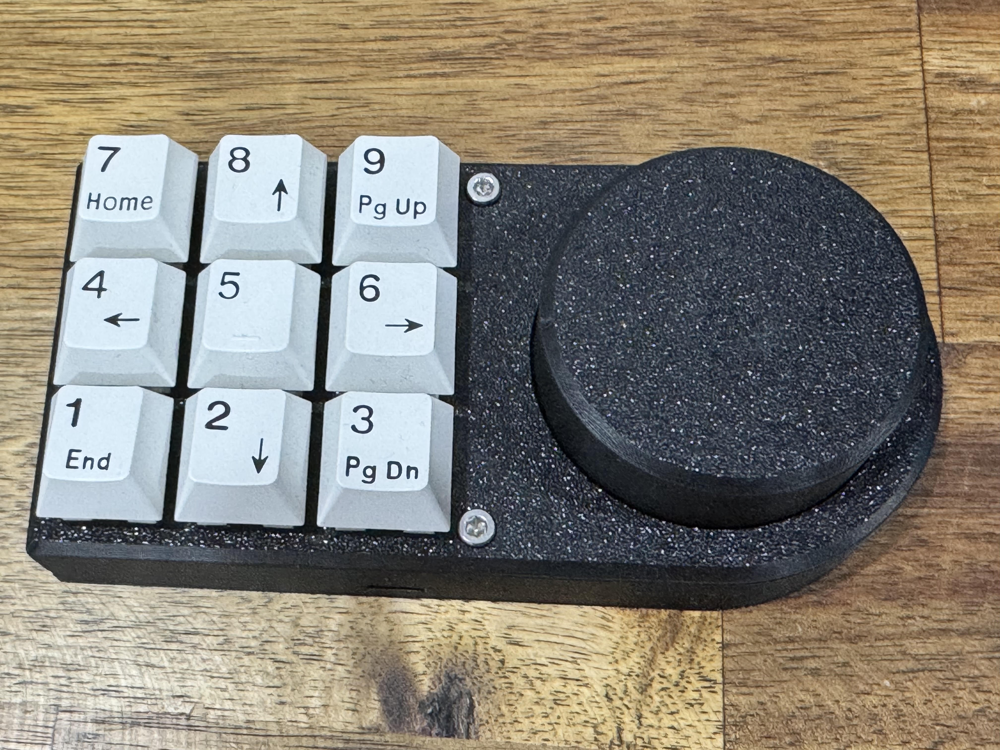

# Programmable USB Macropad

A 9-key Arduino macropad with a rotary encoder, 3 switchable layouts (27 shortcuts) and media controls. It shows up as a standard USB keyboard and media device, so no drivers are needed.

## Features

- **9 programmable keys** across **3 layouts**, giving 27 shortcuts
- **Rotary encoder** for volume control, read using hardware interrupts
- **Encoder button gestures:** single, double and triple press for media controls, plus a 3-second hold to switch layouts
- **USB HID output** for keyboard and media keys, using the [HID-Project](https://github.com/NicoHood/HID) library
- Keys send **F13–F24** and numpad codes that don't clash with normal keyboard shortcuts, so they can be bound in any app (e.g. OBS, AutoHotkey, Discord)

## Hardware

| Component | Qty | Notes |
|---|---|---|
| Arduino Pro Micro (ATmega32U4) | 1 | Needs native USB HID support |
| Mechanical key switches | 9 | [FILL IN: switch type] |
| Rotary encoder with push button | 1 | [FILL IN: e.g. EC11] |
| Keycaps | 9 | |
| Enclosure | 1 | [FILL IN: 3D-printed / other] |

## Wiring

Every input uses the board's internal pull-up resistor. Each key switch connects between its pin and GND, so no external resistors or diodes are needed.

| Input | Pin |
|---|---|
| Encoder CLK (A) | 2 (interrupt) |
| Encoder DT (B) | 3 |
| Encoder button (SW) | 4 |
| Keys 1–6 | 5, 6, 7, 8, 9, 10 |
| Keys 7–9 | 14, 15, 16 |

## Controls

### Encoder

| Action | Result |
|---|---|
| Turn clockwise | Volume up |
| Turn anticlockwise | Volume down |
| Single press | Play / pause |
| Double press (within 1 s) | Next track |
| Triple press (within 1 s) | Previous track |
| Hold 3 s | Switch to the next layout |

When the layout changes, the pad sends numpad `+`, `-` or `*` so host software can tell which layout is active.

### Key layouts

| Key | Layout 1 | Layout 2 | Layout 3 |
|---|---|---|---|
| 1 | F13 | Numpad 0 | F22 |
| 2 | F14 | Numpad 1 | F23 |
| 3 | F15 | Numpad 2 | F24 |
| 4 | F16 | Numpad 3 | Numpad 9 |
| 5 | F17 | Numpad 4 | Numpad . |
| 6 | F18 | Numpad 5 | Numpad \| |
| 7 | F19 | Numpad 6 | Numpad & |
| 8 | F20 | Numpad 7 | Numpad && |
| 9 | F21 | Numpad 8 | Numpad # |

## Setup

1. Install the [Arduino IDE](https://www.arduino.cc/en/software).
2. Install the **HID-Project** library by NicoHood (Sketch → Include Library → Manage Libraries).
3. Open `encoder_media.ino`.
4. Select your board: **Tools → Board → [FILL IN: Arduino Leonardo / SparkFun Pro Micro]**, and choose the correct port.
5. Upload the sketch. The pad works as soon as it's plugged in.

To change what a key does, edit the `layout1()`, `layout2()` or `layout3()` functions.

## Known limitations and future improvements

- Debouncing uses blocking `delay()` calls. Non-blocking `millis()`-based debouncing would keep key scanning responsive.
- Media reports are sent from inside the encoder interrupt. Setting a flag in the ISR and sending from `loop()` would be more reliable.
- Implement standalone software to provide more configuration options for the macropad

## License

[FILL IN: e.g. MIT]
